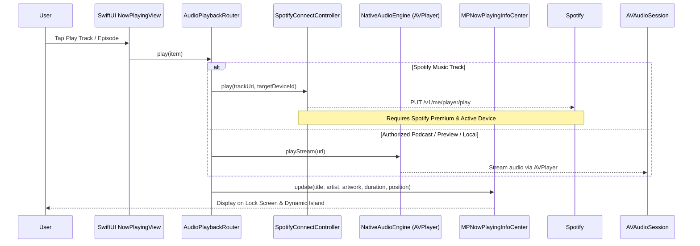

# Myspoti iOS – Architecture Specification (Supported & Compliant)

> **Attribution & Notice**  
> Myspoti iOS is a native iOS client inspired by [Myspoti](https://github.com/kota-zo/myspoti) by kota-zo.  
> Licensed under the **GNU General Public License v3.0 (GPL-3.0)**.  
> In accordance with GPL-3.0 and production platform guidelines, this project relies exclusively on **officially supported, public APIs and SDKs**. It does not implement ad blocking, DRM circumvention, React Fiber inspection, private GraphQL operations, or unauthorized stream extraction.

---

## 1. Architectural Principles & Scope

Following the architecture review, the application is strictly designed around compliant, officially supported platforms:

1. **Official Spotify Platform Integration**:
   * **Authentication**: OAuth 2.0 Authorization Code Flow with **PKCE (Proof Key for Code Exchange)**.
   * **Client Architecture**: Public OAuth client; **zero client secrets** embedded in the binary or stored on-device.
   * **Web API**: Standard REST endpoints (`https://api.spotify.com/v1`) using bearer access tokens.
   * **Remote Control**: Spotify Connect endpoints (`/v1/me/player`) and official Spotify iOS App Remote SDK (where available and eligible).
2. **Audio Architecture Separation**:
   * **Spotify Remote Playback**: Controls playback remotely on active Spotify Connect endpoints (e.g., official Spotify iOS app on the same iPhone, desktop, or smart speaker). Spotify audio is **never** streamed directly through `AVPlayer`.
   * **Native Audio Engine**: Uses `AVPlayer` and `AVAudioSession` exclusively for legally authorized audio sources (e.g. publisher passthrough podcast RSS streams, 30-second preview clips, and user-provided local media).
3. **Native iOS & SwiftUI Engineering**:
   * Modular Swift Package Manager architecture (`MyspotiDomain`, `MyspotiSpotify`, `MyspotiAudio`, `MyspotiUI`).
   * Modern Swift Concurrency (`async`/`await`, `Sendable`, `@MainActor`).
   * iOS 17 `@Observable` state observation.
   * Cloud macOS compilation on Codemagic and personal deployment.

---

## 2. Comparison: Original Android vs. Compliant iOS Architecture

```mermaid
graph TD
    subgraph Original Android Implementation (base/)
        A1[Chromium WebView] -->|Spoof Linux Desktop| A2[Widevine L3 CDM]
        A2 -->|Stream WebSockets| A3[Direct Decrypted Audio]
        A1 -->|React Fiber Inspection| A4[TokenProvider & Internal APIs]
        A1 -->|shouldInterceptRequest| A5[AdBlock & State Machine Tampering]
    end

    subgraph Compliant iOS Implementation (ios/)
        I1[OAuth 2.0 with PKCE] -->|No Client Secret| I2[Apple Keychain Storage]
        I2 -->|Bearer Access Token| I3[Official Spotify Web API REST]
        I3 -->|Spotify Connect API / App Remote| I4[Spotify Remote Playback Target]
        I5[Authorized Media Sources] -->|Passthrough Audio / Previews| I6[Native AVPlayer & AVAudioSession]
        I4 --> I7[MPNowPlayingInfoCenter & MPRemoteCommandCenter]
        I6 --> I7
    end
```

### 2.1 Why the Android Approach Cannot and Must Not Be Ported
* **No Widevine on iOS**: Apple WebKit does not ship Google Widevine. Attempting to run `open.spotify.com` inside a `WKWebView` fails audio decryption.
* **Background Process Throttling**: iOS terminates WebKit JavaScript execution within 30 seconds of backgrounding.
* **Security & Terms**: Inspecting React Fiber or intercepting internal tokens violates platform terms and introduces extreme fragility whenever Spotify deploys internal Web Player revisions.
* **Approved Approach**: Use official OAuth PKCE, official Spotify Web API, and official Spotify Connect / App Remote SDK.

---

## 3. Modular Package Architecture

The iOS workspace is partitioned into decoupled Swift Package Manager targets:

```
ios/
├── Packages/
│   ├── MyspotiDomain/      # Domain models, entities, and service protocols
│   ├── MyspotiSpotify/     # Official Spotify Web API & OAuth PKCE client
│   ├── MyspotiAudio/       # Native AVPlayer, AVAudioSession, and Connect controller
│   └── MyspotiUI/          # AMOLED SwiftUI views and design system components
├── Sources/
│   └── MyspotiApp/         # Application composition root and entry point
├── project.yml             # XcodeGen project specification
└── codemagic.yaml          # Cloud macOS build pipeline
```

### 3.1 `MyspotiDomain`
* **Models**: `Track`, `Album`, `Artist`, `Playlist`, `UserAccount`, `Device`, `PlaybackState`, `QueueItem`, `PodcastEpisode`.
* **Protocols**:
  * `AuthenticationServiceProtocol`: Authorize, token exchange, token refresh, logout.
  * `SpotifyCatalogServiceProtocol`: Search, album details, artist profile, recommendations.
  * `SpotifyLibraryServiceProtocol`: Liked tracks, user playlists, followed artists.
  * `PlaybackControlProtocol`: Play, pause, skip, seek, shuffle, repeat, transfer device.
  * `NativeAudioServiceProtocol`: Play local audio, stream passthrough podcast MP3/M4A.

### 3.2 `MyspotiSpotify`
* **`OAuthPKCECoordinator`**: Generates high-entropy cryptographic `code_verifier` and derives `code_challenge` using SHA-256 (`CryptoKit`). Opens system `ASWebAuthenticationSession` for Spotify login.
* **`KeychainTokenStore`**: Stores access tokens and refresh tokens securely in the iOS Keychain (`kSecClassGenericPassword`, `kSecAttrAccessibleAfterFirstUnlock`).
* **`SpotifyWebAPIClient`**: Robust `URLSession` client handling:
  * Automatic token refresh upon HTTP 401 Unauthorized.
  * Rate-limit handling (`Retry-After` on HTTP 429).
  * Error mapping: `403 Forbidden` (`PREMIUM_REQUIRED`), `404 Not Found` (`NO_ACTIVE_DEVICE`).

### 3.3 `MyspotiAudio`
* **`AudioSessionCoordinator`**: Configures `AVAudioSession` category `.playback`, mode `.default`. Handles audio route changes and incoming call interruptions.
* **`NativeAudioEngine`**: Manages `AVPlayer` for non-DRM streams (authorized podcast passthrough feeds, local media, 30s preview samples).
* **`SpotifyConnectController`**: Dispatches remote playback commands (`PUT /v1/me/player/play`, `/pause`, `/next`, `/seek`) targeting the user's active device.
* **`NowPlayingCenterManager`**: Synchronizes current track metadata, artwork, and playback progress to `MPNowPlayingInfoCenter` and handles `MPRemoteCommandCenter` controls.

### 3.4 `MyspotiUI`
* Pure AMOLED (`#000000`) theme with glassmorphic cards (`.ultraThinMaterial`).
* Custom interactive floating mini-player with gesture expand.
* Full-screen Now Playing modal with scrub bar and haptics.
* Synchronized lyrics viewer integrating [LRCLIB](https://lrclib.net).

---

## 4. Playback Architecture & Audio Separation

To ensure rock-solid stability and zero audio termination:



### 4.1 Strict Audio Boundaries & System Media Control Ownership
1. **No Spotify Track AVPlayer Streaming**: The app never attempts to decode Spotify audio streams in `AVPlayer`. Spotify does not provide unencrypted stream URLs for catalog tracks.
2. **Spotify Remote Control**: Catalog playback commands are routed via Spotify Connect API or the Spotify iOS App Remote SDK to the official Spotify application. The official Spotify app acts as the playback engine and owns the iOS system media session (`MPNowPlayingInfoCenter`, `MPRemoteCommandCenter`, and Dynamic Island) while playing.
3. **Native Media Engine**: `AVPlayer` is reserved strictly for authorized, unencrypted media sources (publisher podcast RSS feeds, 30s preview samples, and local files).
4. **Scoped System Media Controls**: Myspoti activates and manages `MPNowPlayingInfoCenter` and `MPRemoteCommandCenter` **exclusively** during native `AVPlayer` playback. When Spotify remote playback is active, the app defers system media controls to the official Spotify client to avoid audio session conflicts.

---

## 5. Security & Credential Protection

* **Zero Hardcoded Secrets**: With OAuth PKCE, no `client_secret` is used or required. The client is a standard public OAuth client.
* **Keychain Storage**: All tokens (`access_token`, `refresh_token`, expiration timestamp) are encrypted via Apple Keychain Services.
* **Secure Web Auth**: Sign-in is performed via `ASWebAuthenticationSession` (sharing cookies with Safari securely and isolated from third-party keyloggers).
* **Zero Telemetry**: No third-party trackers or external logging platforms are included.

---

## 6. License Compliance & Origin Credit

Myspoti iOS is licensed under **GPL-3.0**.  
Original repository: [https://github.com/kota-zo/myspoti](https://github.com/kota-zo/myspoti)  
All original credits, notices, and source distribution rights are strictly preserved.
