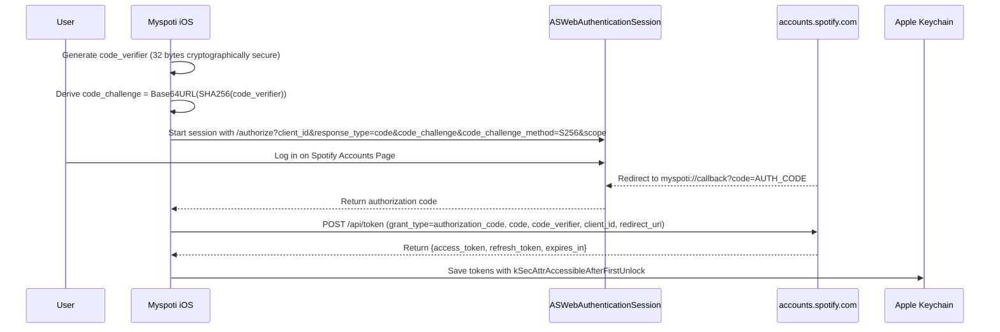

# Myspoti iOS – Official Spotify Integration Specification (2026 Verified)

> **Notice**: Myspoti iOS is an open-source project derived from [Myspoti](https://github.com/kota-zo/myspoti) (GPL-3.0).  
> This specification reflects the **February 2026 Spotify Developer Platform & Web API Migration Guide** and Apple platform requirements.

---

## 1. Spotify 2026 API Platform Restrictions

Following Spotify's platform changes, all Web API calls and development configurations adhere to the strict 2026 constraints:

### 1.1 Developer Mode & Account Governance
* **Spotify Premium Requirement**: The owner of the Spotify Developer application **must** hold an active Spotify Premium subscription. Furthermore, all test users accessing an app in Development Mode must have active Premium accounts to utilize playback and specific private endpoints.
* **Client ID Limitation**: Developers are strictly restricted to **one single Development Mode Client ID** per developer account.
* **User Allowlist Cap**: A maximum of **5 authorized users** can be added to the allowlist under **User Management** in the Spotify Developer Dashboard. Unlisted accounts receive authorization rejection.
* **Zero Client Secrets on iOS**: Utilizing OAuth 2.0 Authorization Code Flow with PKCE, the iOS app acts as a public client with **no embedded client secrets**.

### 1.2 Deprecated & Renamed Endpoints (2026 Migration)
* **Playlist Endpoints Migrated**:
  * Track management has migrated from `/tracks` to `/items`:
    * `GET /v1/playlists/{playlist_id}/items` (replaces `/v1/playlists/{playlist_id}/tracks`).
    * `POST /v1/playlists/{playlist_id}/items` (replaces `/tracks` addition).
    * `DELETE /v1/playlists/{playlist_id}/items` (replaces `/tracks` removal).
  * Playlist creation: `POST /v1/users/{user_id}/playlists` is deprecated in favor of `POST /v1/me/playlists`.
  * Playlist access is scoped primarily to playlists the user owns or collaborates on.
* **Unified Library Endpoints**:
  * Entity-specific library endpoints (`/me/tracks`, `/me/albums`) are superseded by the unified library routes:
    * `PUT /v1/me/library` (save content by Spotify URIs).
    * `DELETE /v1/me/library` (remove content by Spotify URIs).
    * `GET /v1/me/library/contains?uris={uris}` (check saved status).
* **Search Results Capped at 10**:
  * The `GET /v1/search` endpoint strictly limits results to a **maximum of 10 items** per type (`limit=10`). Requests requesting higher limits are rejected or clamped.
* **Removed Endpoints & Data Stripping**:
  * Batch catalog fetch routes (`GET /albums`, `GET /artists`, `GET /episodes`, `GET /shows`) have been removed.
  * Audio features (`/audio-features`), recommendations (`/recommendations`), and new releases (`/browse/new-releases`) are deprecated or restricted.
  * Response payloads have stripped legacy metadata fields, including `popularity`, `available_markets`, and `external_ids`.

---

## 2. Authentication: OAuth 2.0 with PKCE

To protect user credentials and eliminate token leakage risks:
* The user authenticates exclusively through Apple's `ASWebAuthenticationSession`.
* Credentials are exchanged directly with `https://accounts.spotify.com`.
* The client generates a cryptographically random 32-byte `code_verifier` using `SecRandomCopyBytes` and computes the `code_challenge` via `CryptoKit.SHA256` (Base64URL-encoded without padding).
* The redirect URI is registered as `myspoti://callback`.



---

## 3. Remote Playback vs. Native Audio Separation

```
                                      PLAYBACK ROUTER
                                             │
                     ┌───────────────────────┴───────────────────────┐
                     ▼                                               ▼
         SPOTIFY CATALOG TRACKS                           AUTHORIZED NATIVE AUDIO
     (Official Spotify Controller)                     (AVPlayer + AVAudioSession)
                     │                                               │
                     ▼                                               ▼
     Spotify Connect / App Remote SDK                Podcast Passthrough RSS / Previews
  (Directs Official Spotify Application)              (Streams Directly on Device)
                     │                                               │
                     ▼                                               ▼
  Official Spotify App Owns Media Session            Myspoti Owns System Media Controls
   (Dynamic Island & Lock Screen owned               (MPNowPlayingInfoCenter &
     by official Spotify client)                       MPRemoteCommandCenter active)
```

### 3.1 Spotify Remote Playback (App Remote & Connect)
* **Controller Model**: Myspoti acts strictly as a **remote control** for the official Spotify application running on the device or network. Myspoti does not own, stream, or decode Spotify audio files.
* **Tier Constraints (Free vs. Premium)**:
  * **Spotify Premium**: Full interactive control (play arbitrary tracks, skip, seek, and queue).
  * **Spotify Free**: The App Remote and Connect APIs enforce shuffle-only mode or reject on-demand track playback with `403 Forbidden: Premium required`.
* **System Media Controls**:
  * When Spotify playback is active, **the official Spotify application itself owns the iOS system media session**, lock screen controls, and Dynamic Island. Myspoti does not attempt to override `MPNowPlayingInfoCenter` during Spotify playback, avoiding audio session conflicts.

### 3.2 Native Audio Playback (`AVPlayer` + `AVAudioSession`)
* **Authorized Sources Only**: `AVPlayer` is utilized exclusively for non-DRM, legally accessible media:
  * Publisher podcast episodes fetched via authorized RSS feeds or clear passthrough URLs.
  * 30-second audio previews where available.
  * Local media imported into the app container.
* **System Integration**: When playing native audio, Myspoti configures `AVAudioSession` category `.playback` and updates `MPNowPlayingInfoCenter` and `MPRemoteCommandCenter`.

---

## 4. Independent Synchronized Lyrics: LRCLIB

Myspoti does **not** rely on private or undocumented Spotify lyrics endpoints. Lyrics are fetched independently from [LRCLIB](https://lrclib.net):

* **Service Details**: LRCLIB is an open, community-driven lyrics database providing both plain text and time-synchronized lyrics (line-by-line and syllable/word-by-word).
* **API Endpoints**:
  * `GET https://lrclib.net/api/get?track_name={name}&artist_name={artist}&album_name={album}&duration={sec}`
  * `GET https://lrclib.net/api/search?q={query}`
* **Licensing & Terms**:
  * Non-commercial, community-contributed synchronization data.
  * Complies with user-agent requirements (`User-Agent: Myspoti-iOS/1.0 (https://github.com/kota-zo/myspoti)`).
  * Clear attribution to LRCLIB displayed within the lyrics view.

---

## 5. Podcast Playback Architecture

* **No Playable URLs in Spotify Metadata**: Official Spotify Web API episode objects do not contain direct playable stream URLs for non-exclusive podcasts.
* **Architecture**: Podcast feeds are resolved using authorized publisher RSS media enclosures (`enclosure url`) or direct podcast publisher links. Audio is streamed natively using `AVPlayer`.
