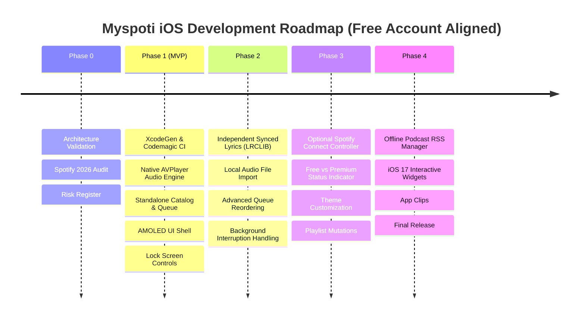

# Myspoti iOS – Technical Roadmap & Free Account Strategy

> **Attribution**: Based on [Myspoti](https://github.com/kota-zo/myspoti) (GPL-3.0).

---

## 1. Free Account Development Strategy

Because the project owner and target personal users operate on a **Spotify Free** tier without a paid Spotify Premium subscription:

1. **No Paid Prerequisite**: The application **does not** require Spotify Premium, paid developer memberships, or paid cloud APIs to build, run, or use.
2. **Immediate Launch Without Auth**: The application launches directly into full functionality in **Standalone / Native Audio Mode**. Spotify authentication is completely optional and accessible via Settings.
3. **Real Native Audio (`AVPlayer`)**: The application includes a functional native audio engine utilizing `AVPlayer`, `AVAudioSession`, and `MPNowPlayingInfoCenter`. It streams legally accessible audio samples, user-imported local files, and authorized podcast RSS audio directly on the iPhone with complete background playback and lockscreen controls.
4. **Modularity & Dependency Injection**: Repository protocols (`CatalogRepositoryProtocol`, `PlaybackRepositoryProtocol`, `LibraryRepositoryProtocol`) decouple the UI from data providers. The app runs on standalone repositories today and seamlessly connects to official Spotify endpoints whenever verified authorization is present.

---

## 2. Phased Milestones

### Phase 1: MVP & Standalone Audio Shell *(Completed)*
* **Objective**: Deliver a complete, standalone iOS music player shell that builds on cloud macOS (Codemagic) and installs on an iPhone via a free Apple ID without requiring a Spotify login or Premium subscription.
* **Core Deliverables**:
  1. **Build Infrastructure**:
     * XcodeGen configuration (`project.yml`) generating `Myspoti.xcodeproj`.
     * Codemagic CI pipeline (`codemagic.yaml`) generating unsigned `.ipa` artifacts.
  2. **Decoupled Architecture**:
     * `MyspotiDomain`: Models (`Track`, `Album`, `Artist`, `Playlist`, `PlaybackState`, `Queue`, `Lyrics`, `UserProfile`) and protocols.
     * `MyspotiAudio`: Real `AVPlayer` engine, `AVAudioSession` (.playback) background audio, `MPNowPlayingInfoCenter`, and `MPRemoteCommandCenter`.
     * `MyspotiNetwork`: RFC 7636 PKCE coordinator, `KeychainTokenStore`, and `HTTPClient`.
     * `MyspotiUI`: True AMOLED (`#000000`) theme, `HomeView`, `SearchView`, `LibraryView`, `AlbumDetailView`, `ArtistDetailView`, `PlaylistDetailView`, `MiniPlayerView`, `FullScreenPlayerView`, `QueueView`, `LyricsSheetView`, `SettingsView`, and `ProfileView`.
  3. **Audio Functionality**:
     * Live playback of authorized audio streams via `AVPlayer`.
     * Live scrub bar, time tracking, seek, play/pause, next/previous.
     * Lock Screen and Control Center controls active for native playback.
  4. **Offline & Preview Readiness**:
     * Fully populated mock catalog and library with no network dependencies required at launch.

---

### Phase 2: Enhanced Local Audio & Lyrics – Version 1.1
* **Objective**: Add document picker for local file playback and connect live LRCLIB lyrics.
* **Milestones**:
  1. **Local Audio Importer**:
     * Import local audio files (`.mp3`, `.m4a`, `.flac`) via `UIDocumentPickerViewController` into the app sandbox.
     * Read ID3 tags (embedded artwork, title, artist) using `AVAsset`.
  2. **Live LRCLIB Client**:
     * Connect live LRCLIB REST client (`https://lrclib.net/api/get`) for real-time lyrics fetching.
  3. **Queue Drag-and-Drop**:
     * Interactive SwiftUI `.onMove` reordering in `QueueView`.

---

### Phase 3: Optional Spotify Connect Integration – Version 1.2
* **Objective**: Add optional Spotify OAuth PKCE sign-in for users with Spotify accounts.
* **Milestones**:
  1. **Settings Connect Button**:
     * Optional "Connect Spotify Account" button inside Settings.
  2. **Graceful Tier Notification**:
     * Detects Free vs. Premium status. If Free, explains that remote playback requires Premium and offers deep-linking to the official Spotify app.

---

### Phase 4: System Polish & Widgets – Version 1.3
* **Objective**: iOS 17 system extensions and performance tuning.
* **Milestones**:
  1. **Interactive Widgets**: Home Screen and Lock Screen widgets with play/pause intents.
  2. **Dynamic Island**: Live Activity support for native audio playback.
